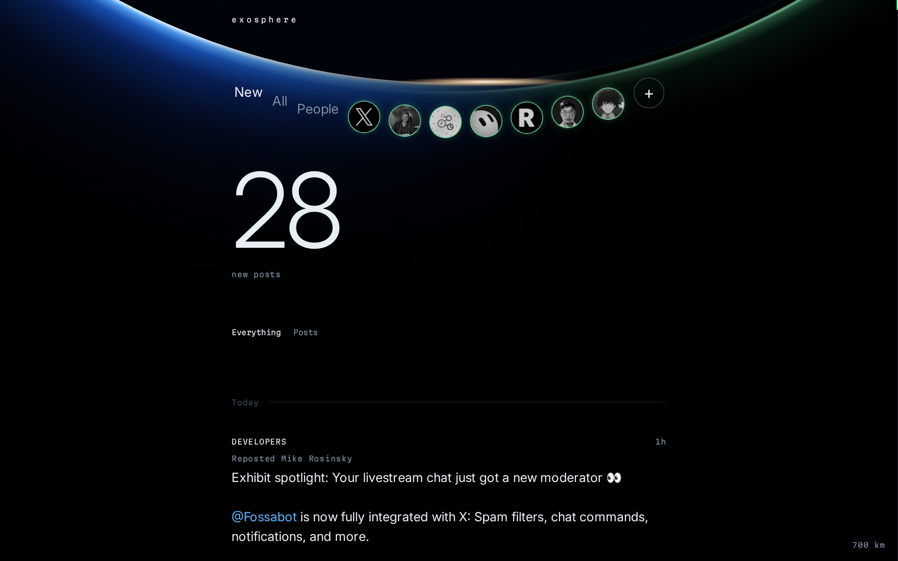
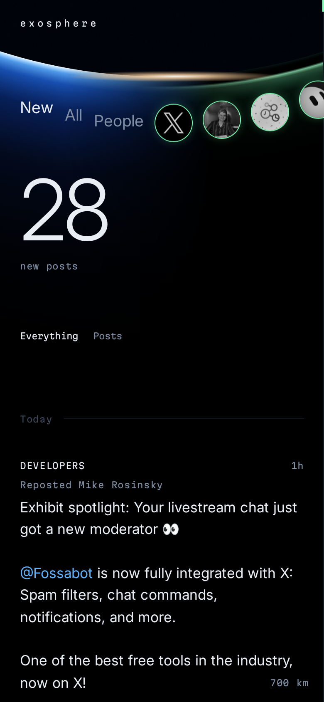
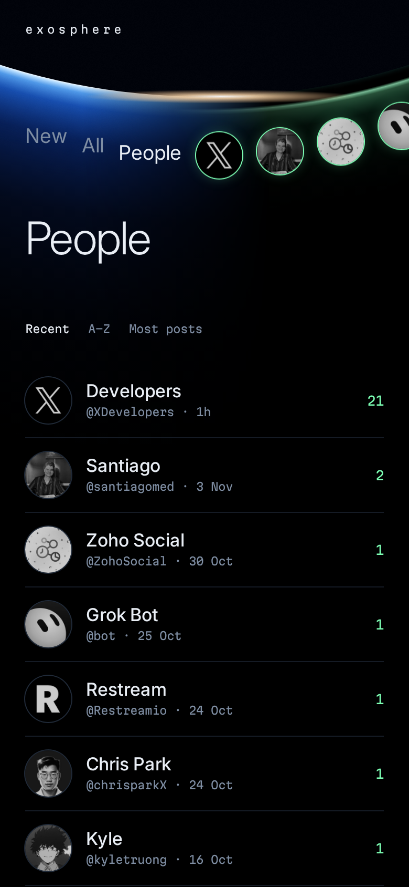
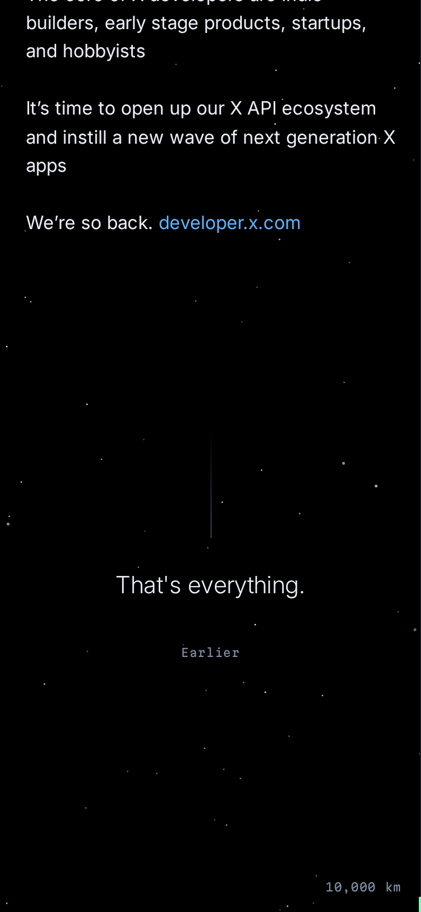

# exosphere

The people you choose on X, and nothing else. No algorithm, no counts, and the feed ends.



<p>
  
  
  
</p>

Add people by name or handle. A slow background poller reads their posts through a
burner account into SQLite, and the site shows what's new since you last checked.

## Run

```
uv sync
uv run exosphere serve
```

It listens on `127.0.0.1:4600` and has no login, so keep it behind something private
such as Tailscale.

## Connect an X account

Sign in to the burner in a browser and copy its `auth_token` and `ct0` cookies:

```
echo '{"auth_token":"...","ct0":"..."}' | uv run exosphere account <username>
```

Session cookies are kept in `~/.local/share/exosphere/accounts.db`.

## Settings

Environment variables: `EXOSPHERE_DATA`, `EXOSPHERE_HOST`, `EXOSPHERE_PORT`,
`EXOSPHERE_CYCLE_MINUTES` (default 30), `EXOSPHERE_MIN_GAP_SECONDS` (default 60),
`EXOSPHERE_NTFY_URL` (pinged when the account stops working).

## Credits

Built on [twscrape](https://github.com/vladkens/twscrape) (MIT), which also supplied the
recorded response in `tests/fixtures`. The screenshots show that recording. Fonts are Inter and Martian Mono (SIL OFL,
licenses in `exosphere/static/fonts`).

Scraping X is against its terms. Use an account you can afford to lose.
